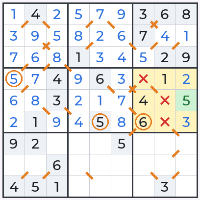

<!-- Written by tools/walkthrough.py diagonal-consecutive: edit the script, not this page. -->
# Diagonal Consecutive, step 35: the 5 in box 6

**Step 35 of 57** · [← Step 34](step-34.md) · [All steps](../diagonal-consecutive.md#the-whole-puzzle-step-by-step) · [Step 36 →](step-36.md)

Box 6 needs a 5. r4c7: row 4 has one (r4c1). r6c8: row 6 has one (r6c5). r5c8: it touches the 6 in r6c7 at a corner with no mark between them, and 5 is 1 away from it. Only **r5c9** is left: **r5c9 = 5**.

**Step 35 of 57** · [← Step 34](step-34.md) · [All steps](../diagonal-consecutive.md#the-whole-puzzle-step-by-step) · [Step 36 →](step-36.md)
