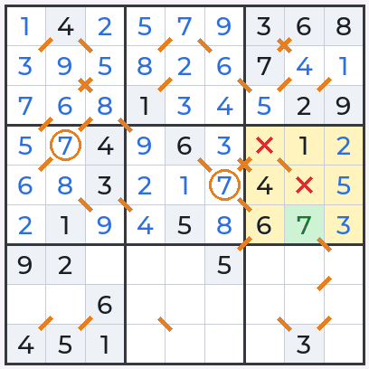

<!-- Written by tools/walkthrough.py diagonal-consecutive: edit the script, not this page. -->
# Diagonal Consecutive, step 36: the 7 in box 6

**Step 36 of 57** · [← Step 35](step-35.md) · [All steps](../diagonal-consecutive.md#the-whole-puzzle-step-by-step) · [Step 37 →](step-37.md)

Box 6 needs a 7. r4c7: row 4 has one (r4c2). r5c8: row 5 has one (r5c6). Only **r6c8** is left: **r6c8 = 7**.

**Step 36 of 57** · [← Step 35](step-35.md) · [All steps](../diagonal-consecutive.md#the-whole-puzzle-step-by-step) · [Step 37 →](step-37.md)
