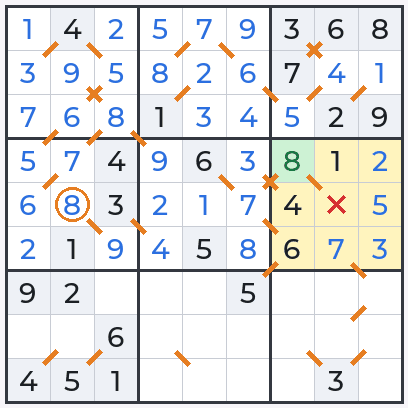

<!-- Written by tools/walkthrough.py diagonal-consecutive: edit the script, not this page. -->
# Diagonal Consecutive, step 37: the 8 in box 6

**Step 37 of 57** · [← Step 36](step-36.md) · [All steps](../diagonal-consecutive.md#the-whole-puzzle-step-by-step) · [Step 38 →](step-38.md)

Box 6 needs an 8. r5c8: row 5 has one (r5c2). Only **r4c7** is left: **r4c7 = 8**.

**Step 37 of 57** · [← Step 36](step-36.md) · [All steps](../diagonal-consecutive.md#the-whole-puzzle-step-by-step) · [Step 38 →](step-38.md)
