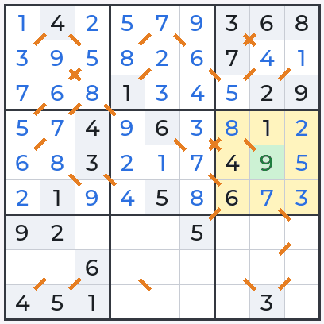

<!-- Written by tools/walkthrough.py diagonal-consecutive: edit the script, not this page. -->
# Diagonal Consecutive, step 38: the 9 in box 6

**Step 38 of 57** · [← Step 37](step-37.md) · [All steps](../diagonal-consecutive.md#the-whole-puzzle-step-by-step) · [Step 39 →](step-39.md)

Box 6 needs a 9, and r5c8 is its last empty cell: **r5c8 = 9**.

**Step 38 of 57** · [← Step 37](step-37.md) · [All steps](../diagonal-consecutive.md#the-whole-puzzle-step-by-step) · [Step 39 →](step-39.md)
