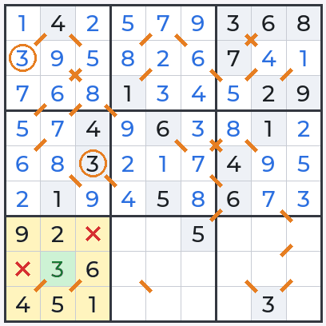

<!-- Written by tools/walkthrough.py diagonal-consecutive: edit the script, not this page. -->
# Diagonal Consecutive, step 39: the 3 in box 7

**Step 39 of 57** · [← Step 38](step-38.md) · [All steps](../diagonal-consecutive.md#the-whole-puzzle-step-by-step) · [Step 40 →](step-40.md)

Box 7 needs a 3. r7c3: column 3 has one (r5c3). r8c1: column 1 has one (r2c1). Only **r8c2** is left: **r8c2 = 3**.

**Step 39 of 57** · [← Step 38](step-38.md) · [All steps](../diagonal-consecutive.md#the-whole-puzzle-step-by-step) · [Step 40 →](step-40.md)
