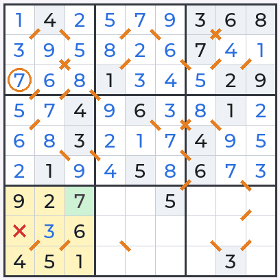

<!-- Written by tools/walkthrough.py diagonal-consecutive: edit the script, not this page. -->
# Diagonal Consecutive, step 40: the 7 in box 7

**Step 40 of 57** · [← Step 39](step-39.md) · [All steps](../diagonal-consecutive.md#the-whole-puzzle-step-by-step) · [Step 41 →](step-41.md)

Box 7 needs a 7. r8c1: column 1 has one (r3c1). Only **r7c3** is left: **r7c3 = 7**.

**Step 40 of 57** · [← Step 39](step-39.md) · [All steps](../diagonal-consecutive.md#the-whole-puzzle-step-by-step) · [Step 41 →](step-41.md)
