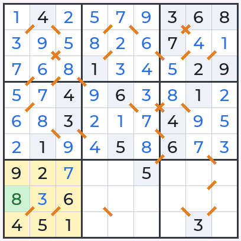

<!-- Written by tools/walkthrough.py diagonal-consecutive: edit the script, not this page. -->
# Diagonal Consecutive, step 41: the 8 in box 7

**Step 41 of 57** · [← Step 40](step-40.md) · [All steps](../diagonal-consecutive.md#the-whole-puzzle-step-by-step) · [Step 42 →](step-42.md)

Box 7 needs an 8, and r8c1 is its last empty cell: **r8c1 = 8**.

**Step 41 of 57** · [← Step 40](step-40.md) · [All steps](../diagonal-consecutive.md#the-whole-puzzle-step-by-step) · [Step 42 →](step-42.md)
