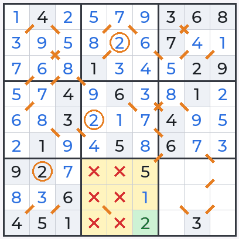

<!-- Written by tools/walkthrough.py diagonal-consecutive: edit the script, not this page. -->
# Diagonal Consecutive, step 43: the 2 in box 8

**Step 43 of 57** · [← Step 42](step-42.md) · [All steps](../diagonal-consecutive.md#the-whole-puzzle-step-by-step) · [Step 44 →](step-44.md)

Box 8 needs a 2. r7c4 and r7c5: row 7 has one (r7c2). r8c4 and r9c4: column 4 has one (r5c4). r8c5 and r9c5: column 5 has one (r2c5). Only **r9c6** is left: **r9c6 = 2**.

**Step 43 of 57** · [← Step 42](step-42.md) · [All steps](../diagonal-consecutive.md#the-whole-puzzle-step-by-step) · [Step 44 →](step-44.md)
