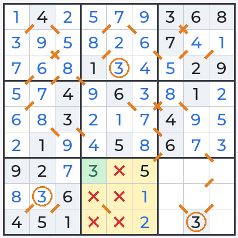

<!-- Written by tools/walkthrough.py diagonal-consecutive: edit the script, not this page. -->
# Diagonal Consecutive, step 44: the 3 in box 8

**Step 44 of 57** · [← Step 43](step-43.md) · [All steps](../diagonal-consecutive.md#the-whole-puzzle-step-by-step) · [Step 45 →](step-45.md)

Box 8 needs a 3. r7c5: column 5 has one (r3c5). r8c4 and r8c5: row 8 has one (r8c2). r9c4 and r9c5: row 9 has one (r9c8). Only **r7c4** is left: **r7c4 = 3**.

**Step 44 of 57** · [← Step 43](step-43.md) · [All steps](../diagonal-consecutive.md#the-whole-puzzle-step-by-step) · [Step 45 →](step-45.md)
