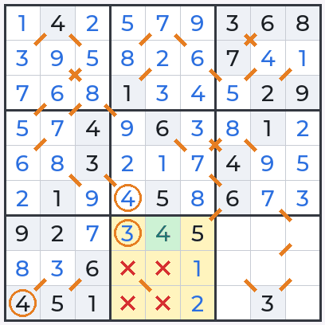

<!-- Written by tools/walkthrough.py diagonal-consecutive: edit the script, not this page. -->
# Diagonal Consecutive, step 45: the 4 in box 8

**Step 45 of 57** · [← Step 44](step-44.md) · [All steps](../diagonal-consecutive.md#the-whole-puzzle-step-by-step) · [Step 46 →](step-46.md)

Box 8 needs a 4. r8c4: column 4 has one (r6c4). r9c4 and r9c5: row 9 has one (r9c1). r8c5: it touches the 3 in r7c4 at a corner with no mark between them, and 4 is 1 away from it. Only **r7c5** is left: **r7c5 = 4**.

**Step 45 of 57** · [← Step 44](step-44.md) · [All steps](../diagonal-consecutive.md#the-whole-puzzle-step-by-step) · [Step 46 →](step-46.md)
