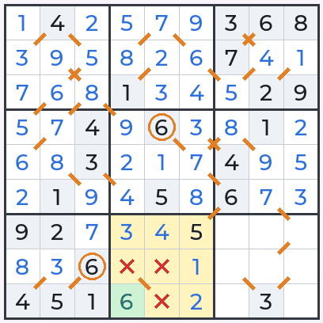

<!-- Written by tools/walkthrough.py diagonal-consecutive: edit the script, not this page. -->
# Diagonal Consecutive, step 46: the 6 in box 8

**Step 46 of 57** · [← Step 45](step-45.md) · [All steps](../diagonal-consecutive.md#the-whole-puzzle-step-by-step) · [Step 47 →](step-47.md)

Box 8 needs a 6. r8c4 and r8c5: row 8 has one (r8c3). r9c5: column 5 has one (r4c5). Only **r9c4** is left: **r9c4 = 6**.

**Step 46 of 57** · [← Step 45](step-45.md) · [All steps](../diagonal-consecutive.md#the-whole-puzzle-step-by-step) · [Step 47 →](step-47.md)
