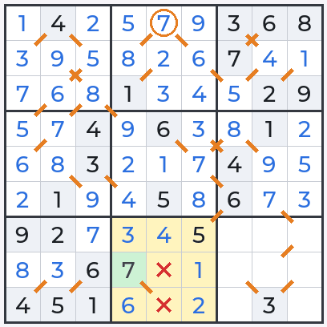

<!-- Written by tools/walkthrough.py diagonal-consecutive: edit the script, not this page. -->
# Diagonal Consecutive, step 47: the 7 in box 8

**Step 47 of 57** · [← Step 46](step-46.md) · [All steps](../diagonal-consecutive.md#the-whole-puzzle-step-by-step) · [Step 48 →](step-48.md)

Box 8 needs a 7. r8c5 and r9c5: column 5 has one (r1c5). Only **r8c4** is left: **r8c4 = 7**.

**Step 47 of 57** · [← Step 46](step-46.md) · [All steps](../diagonal-consecutive.md#the-whole-puzzle-step-by-step) · [Step 48 →](step-48.md)
