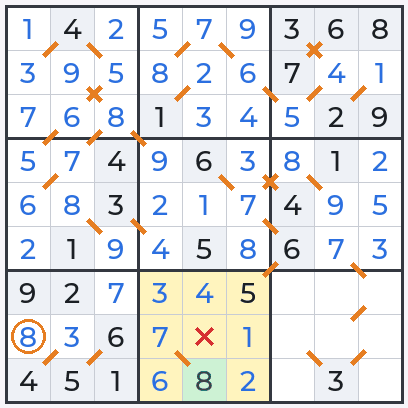

<!-- Written by tools/walkthrough.py diagonal-consecutive: edit the script, not this page. -->
# Diagonal Consecutive, step 48: the 8 in box 8

**Step 48 of 57** · [← Step 47](step-47.md) · [All steps](../diagonal-consecutive.md#the-whole-puzzle-step-by-step) · [Step 49 →](step-49.md)

Box 8 needs an 8. r8c5: row 8 has one (r8c1). Only **r9c5** is left: **r9c5 = 8**.

**Step 48 of 57** · [← Step 47](step-47.md) · [All steps](../diagonal-consecutive.md#the-whole-puzzle-step-by-step) · [Step 49 →](step-49.md)
