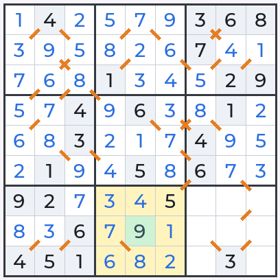

<!-- Written by tools/walkthrough.py diagonal-consecutive: edit the script, not this page. -->
# Diagonal Consecutive, step 49: the 9 in box 8

**Step 49 of 57** · [← Step 48](step-48.md) · [All steps](../diagonal-consecutive.md#the-whole-puzzle-step-by-step) · [Step 50 →](step-50.md)

Box 8 needs a 9, and r8c5 is its last empty cell: **r8c5 = 9**.

**Step 49 of 57** · [← Step 48](step-48.md) · [All steps](../diagonal-consecutive.md#the-whole-puzzle-step-by-step) · [Step 50 →](step-50.md)
