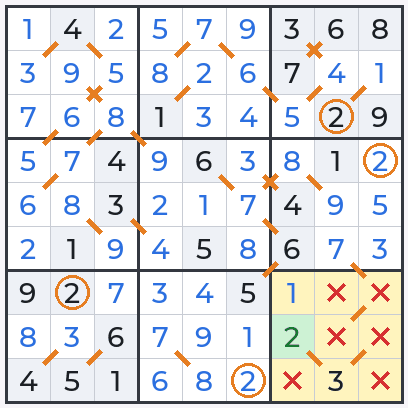

<!-- Written by tools/walkthrough.py diagonal-consecutive: edit the script, not this page. -->
# Diagonal Consecutive, step 51: the 2 in box 9

**Step 51 of 57** · [← Step 50](step-50.md) · [All steps](../diagonal-consecutive.md#the-whole-puzzle-step-by-step) · [Step 52 →](step-52.md)

Box 9 needs a 2. r7c8 and r7c9: row 7 has one (r7c2). r8c8: column 8 has one (r3c8). r8c9: column 9 has one (r4c9). r9c7 and r9c9: row 9 has one (r9c6). Only **r8c7** is left: **r8c7 = 2**.

**Step 51 of 57** · [← Step 50](step-50.md) · [All steps](../diagonal-consecutive.md#the-whole-puzzle-step-by-step) · [Step 52 →](step-52.md)
