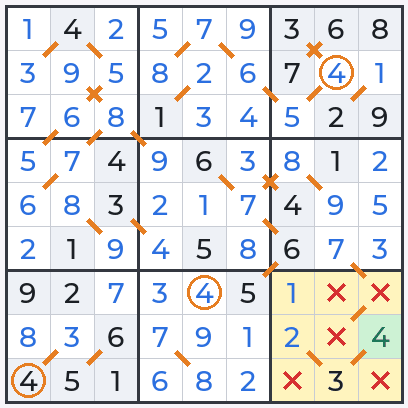

<!-- Written by tools/walkthrough.py diagonal-consecutive: edit the script, not this page. -->
# Diagonal Consecutive, step 52: the 4 in box 9

**Step 52 of 57** · [← Step 51](step-51.md) · [All steps](../diagonal-consecutive.md#the-whole-puzzle-step-by-step) · [Step 53 →](step-53.md)

Box 9 needs a 4. r7c8 and r7c9: row 7 has one (r7c5). r8c8: column 8 has one (r2c8). r9c7 and r9c9: row 9 has one (r9c1). Only **r8c9** is left: **r8c9 = 4**.

**Step 52 of 57** · [← Step 51](step-51.md) · [All steps](../diagonal-consecutive.md#the-whole-puzzle-step-by-step) · [Step 53 →](step-53.md)
