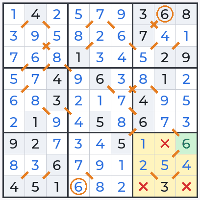

<!-- Written by tools/walkthrough.py diagonal-consecutive: edit the script, not this page. -->
# Diagonal Consecutive, step 54: the 6 in box 9

**Step 54 of 57** · [← Step 53](step-53.md) · [All steps](../diagonal-consecutive.md#the-whole-puzzle-step-by-step) · [Step 55 →](step-55.md)

Box 9 needs a 6. r7c8: column 8 has one (r1c8). r9c7 and r9c9: row 9 has one (r9c4). Only **r7c9** is left: **r7c9 = 6**.

**Step 54 of 57** · [← Step 53](step-53.md) · [All steps](../diagonal-consecutive.md#the-whole-puzzle-step-by-step) · [Step 55 →](step-55.md)
