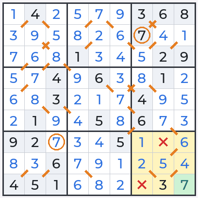

<!-- Written by tools/walkthrough.py diagonal-consecutive: edit the script, not this page. -->
# Diagonal Consecutive, step 55: the 7 in box 9

**Step 55 of 57** · [← Step 54](step-54.md) · [All steps](../diagonal-consecutive.md#the-whole-puzzle-step-by-step) · [Step 56 →](step-56.md)

Box 9 needs a 7. r7c8: row 7 has one (r7c3). r9c7: column 7 has one (r2c7). Only **r9c9** is left: **r9c9 = 7**.

**Step 55 of 57** · [← Step 54](step-54.md) · [All steps](../diagonal-consecutive.md#the-whole-puzzle-step-by-step) · [Step 56 →](step-56.md)
