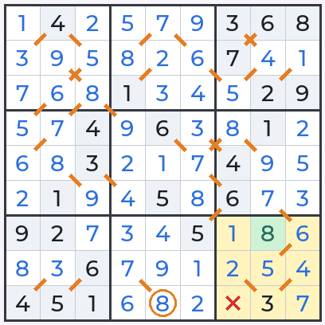

<!-- Written by tools/walkthrough.py diagonal-consecutive: edit the script, not this page. -->
# Diagonal Consecutive, step 56: the 8 in box 9

**Step 56 of 57** · [← Step 55](step-55.md) · [All steps](../diagonal-consecutive.md#the-whole-puzzle-step-by-step) · [Step 57 →](step-57.md)

Box 9 needs an 8. r9c7: row 9 has one (r9c5). Only **r7c8** is left: **r7c8 = 8**.

**Step 56 of 57** · [← Step 55](step-55.md) · [All steps](../diagonal-consecutive.md#the-whole-puzzle-step-by-step) · [Step 57 →](step-57.md)
