# Diagonal Non-Consecutive

[← All variants](README.md) · [Puzzles](../features-puzzles.md) · [How to play](../how-to-play.md)

## The rules

[Classic](classic.md) rules, and **two cells that touch at a corner never hold digits 1 apart**: next to a 5, the four cells diagonally around it can't be 4 or 6. Side by side doesn't count (that's [Non-Consecutive](non-consecutive.md)): a 4 can sit right next to a 5.

## On the board

- Nothing extra is drawn: the rule is about every cell.
- Two digits 1 apart at a corner turn red.
- The grader and hints take a digit out of a cell when a cell at its corner can only be one of its two neighbours: "The cells touching row 3, column 3 at its corners can't be 1 apart from it, which leaves it only 7".
- **Puzzles → ⋮ → New puzzle → Marks → Diagonal NC**.

## How to solve it

- **Each digit rules out two more at its corners:** a 5 keeps 4 and 6 out of its four diagonal neighbours, on top of its row, column and box.
- **1 and 9 are the gentlest:** they rule out only one digit at their corners (2, or 8).
- **A corner cell with two candidates 2 apart** (like 4 and 6) keeps the digit between them (5) out of the cells at its corners.
- **Inside a box, the corners count too:** a box's centre touches all four of its corner cells.

## Worked example

**variant-examples #37**, Diagonal Non-Consecutive Easy (see [Classic](classic.md#worked-example-the-whole-puzzle) for how to import the examples; cells are written r*row*c*column*).

**Step 1: r2c7.** Row 2 has 2, 3, 4 and 9; column 7 has a 7; box 3 has 6 and 8: that leaves 1 and 5. r3c8, at its lower-right corner, is a 6: a 5 would be 1 away. **r2c7 = 1**.

**Step 2: r3c3.** Row 3 has 5, 6 and 8; column 3 has 2 and 4; box 1 has 1 and 9: that leaves 3 and 7. r2c4, at its upper-right corner, is a 4: a 3 would be 1 away. **r3c3 = 7**.

**Step 3: r5c2.** Row 5 has 2, 3, 5, 6, 7 and 8; column 2 has a 9: that leaves 1 and 4. r6c3, at its lower-right corner, is a 2: a 1 would be 1 away. **r5c2 = 4**.

## The whole puzzle, step by step

<!-- walkthrough -->
<!-- Written by tools/walkthrough.py diagonal-non-consecutive: edit the script, not this part. -->

The whole puzzle, from the start to the last cell: 47 steps, each one a single (one place left for a digit, or one digit left for a cell), taken in the order a box's single comes first, so not quite the order of the worked example above. In each picture, the unit the step looks at is tinted yellow (for a cell with one digit left: its row, column and box), the new digit is on green, the digits that rule cells out have an **orange ring**, and the empty cells they rule out a **red cross**. Givens are on grey, digits from earlier steps in blue.

#### Step 1: the 5 in box 2

Box 2 needs a 5. r3c4 and r3c5: row 3 has one (r3c1). r1c5: it touches the 4 in r2c4 at a corner, and 5 is 1 away from it. Only **r2c6** is left: **r2c6 = 5**.

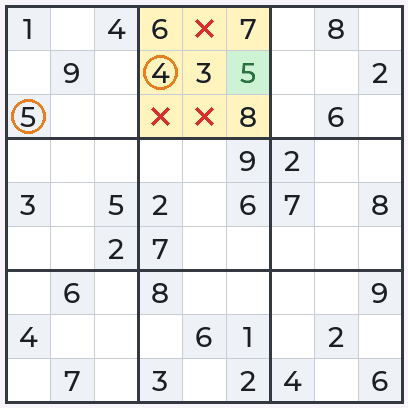

#### Step 2: the 4 in box 3

Box 3 needs a 4. r1c7 and r1c9: row 1 has one (r1c3). r2c7 and r2c8: row 2 has one (r2c4). r3c7: column 7 has one (r9c7). Only **r3c9** is left: **r3c9 = 4**.

#### Step 3: the 7 in box 3

Box 3 needs a 7. r1c7 and r1c9: row 1 has one (r1c6). r2c7 and r3c7: column 7 has one (r5c7). Only **r2c8** is left: **r2c8 = 7**.

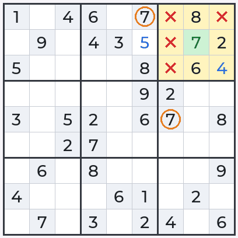

#### Step 4: the 7 in box 1

Box 1 needs a 7. r1c2: row 1 has one (r1c6). r2c1 and r2c3: row 2 has one (r2c8). r3c2: column 2 has one (r9c2). Only **r3c3** is left: **r3c3 = 7**.

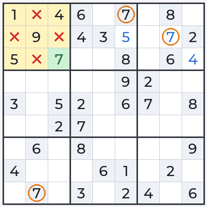

#### Step 5: the 4 in box 4

Box 4 needs a 4. r4c1 and r6c1: column 1 has one (r8c1). r4c3: column 3 has one (r1c3). r4c2: it touches the 5 in r3c1 at a corner, and 4 is 1 away from it. r6c2: it touches the 3 in r5c1 at a corner, and 4 is 1 away from it. Only **r5c2** is left: **r5c2 = 4**.

#### Step 6: the 7 in box 4

Box 4 needs a 7. r4c2: column 2 has one (r9c2). r4c3: column 3 has one (r3c3). r6c1 and r6c2: row 6 has one (r6c4). Only **r4c1** is left: **r4c1 = 7**.

#### Step 7: the 9 in box 4

Box 4 needs a 9. r4c2 and r4c3: row 4 has one (r4c6). r6c2: column 2 has one (r2c2). Only **r6c1** is left: **r6c1 = 9**.

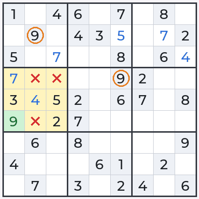

#### Step 8: the 6 in box 4

Box 4 needs a 6. r4c2 and r6c2: column 2 has one (r7c2). Only **r4c3** is left: **r4c3 = 6**.

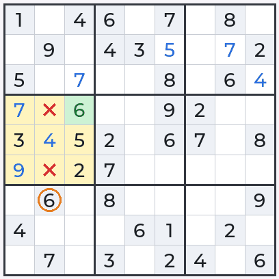

#### Step 9: the 6 in box 1

Box 1 needs a 6. r1c2: row 1 has one (r1c4). r2c3: column 3 has one (r4c3). r3c2: row 3 has one (r3c8). Only **r2c1** is left: **r2c1 = 6**.

#### Step 10: the 8 in box 1

Box 1 needs an 8. r1c2: row 1 has one (r1c8). r3c2: row 3 has one (r3c6). Only **r2c3** is left: **r2c3 = 8**.

#### Step 11: the 8 in box 4

Box 4 needs an 8. r4c2: it touches the 7 in r3c3 at a corner, and 8 is 1 away from it. Only **r6c2** is left: **r6c2 = 8**.

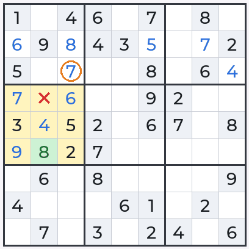

#### Step 12: the 1 in box 4

Box 4 needs a 1, and r4c2 is its last empty cell: **r4c2 = 1**.

#### Step 13: the 1 in box 5

Box 5 needs a 1. r4c4 and r4c5: row 4 has one (r4c2). r6c6: column 6 has one (r8c6). r6c5: it touches the 2 in r5c4 at a corner, and 1 is 1 away from it. Only **r5c5** is left: **r5c5 = 1**.

#### Step 14: the 1 in box 2

Box 2 needs a 1. r1c5: row 1 has one (r1c1). r3c5: column 5 has one (r5c5). Only **r3c4** is left: **r3c4 = 1**.

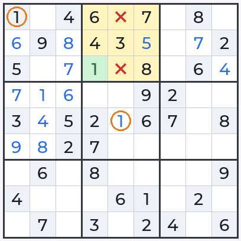

#### Step 15: the 1 in box 3

Box 3 needs a 1. r1c7 and r1c9: row 1 has one (r1c1). r3c7: row 3 has one (r3c4). Only **r2c7** is left: **r2c7 = 1**.

#### Step 16: the 3 in box 5

Box 5 needs a 3. r4c4: column 4 has one (r9c4). r4c5 and r6c5: column 5 has one (r2c5). Only **r6c6** is left: **r6c6 = 3**.

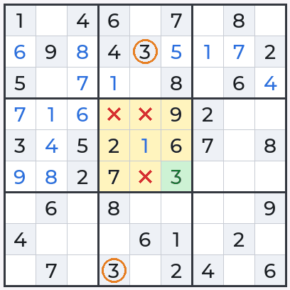

#### Step 17: the 5 in box 5

Box 5 needs a 5. r4c5 and r6c5: it touches the 6 in r5c6 at a corner, and 5 is 1 away from it. Only **r4c4** is left: **r4c4 = 5**.

#### Step 18: the 8 in box 5

Box 5 needs an 8. r6c5: row 6 has one (r6c2). Only **r4c5** is left: **r4c5 = 8**.

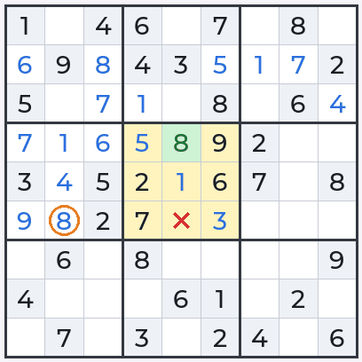

#### Step 19: the 4 in box 5

Box 5 needs a 4, and r6c5 is its last empty cell: **r6c5 = 4**.

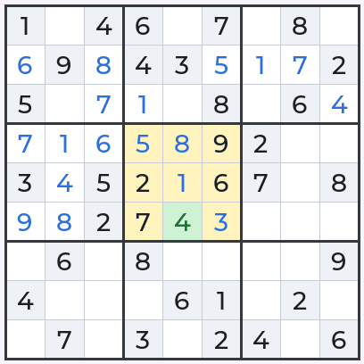

#### Step 20: the 3 in box 6

Box 6 needs a 3. r5c8: row 5 has one (r5c1). r6c7, r6c8 and r6c9: row 6 has one (r6c6). r4c8: it touches the 4 in r3c9 at a corner, and 3 is 1 away from it. Only **r4c9** is left: **r4c9 = 3**.

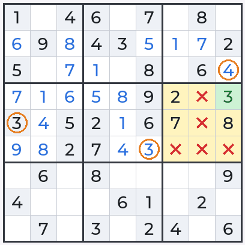

#### Step 21: the 4 in box 6

Box 6 needs a 4. r5c8: row 5 has one (r5c2). r6c7, r6c8 and r6c9: row 6 has one (r6c5). Only **r4c8** is left: **r4c8 = 4**.

#### Step 22: the 3 in box 3

Box 3 needs a 3. r1c9: column 9 has one (r4c9). r3c7: it touches the 4 in r4c8 at a corner, and 3 is 1 away from it. Only **r1c7** is left: **r1c7 = 3**.

#### Step 23: the 3 in box 1

Box 1 needs a 3. r1c2: row 1 has one (r1c7). Only **r3c2** is left: **r3c2 = 3**.

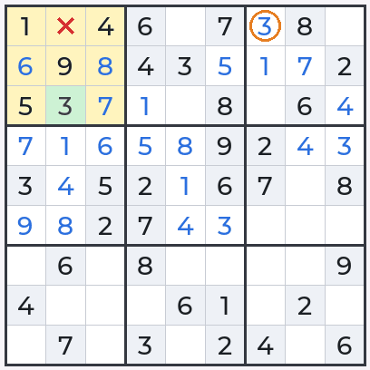

#### Step 24: the 2 in box 1

Box 1 needs a 2, and r1c2 is its last empty cell: **r1c2 = 2**.

#### Step 25: the 2 in box 2

Box 2 needs a 2. r1c5: row 1 has one (r1c2). Only **r3c5** is left: **r3c5 = 2**.

#### Step 26: the 9 in box 2

Box 2 needs a 9, and r1c5 is its last empty cell: **r1c5 = 9**.

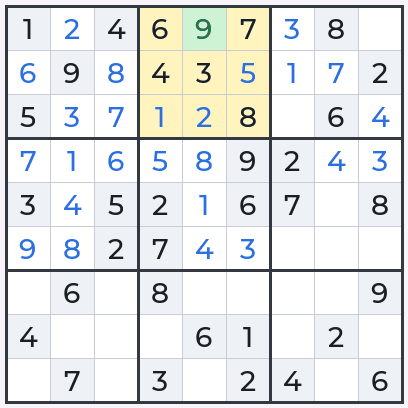

#### Step 27: the 5 in box 3

Box 3 needs a 5. r3c7: row 3 has one (r3c1). Only **r1c9** is left: **r1c9 = 5**.

#### Step 28: the 9 in box 3

Box 3 needs a 9, and r3c7 is its last empty cell: **r3c7 = 9**.

#### Step 29: the 5 in box 6

Box 6 needs a 5. r5c8: row 5 has one (r5c3). r6c9: column 9 has one (r1c9). r6c7: it touches the 6 in r5c6 at a corner, and 5 is 1 away from it. Only **r6c8** is left: **r6c8 = 5**.

#### Step 30: the 1 in box 6

Box 6 needs a 1. r5c8: row 5 has one (r5c5). r6c7: column 7 has one (r2c7). Only **r6c9** is left: **r6c9 = 1**.

#### Step 31: the 6 in box 6

Box 6 needs a 6. r5c8: row 5 has one (r5c6). Only **r6c7** is left: **r6c7 = 6**.

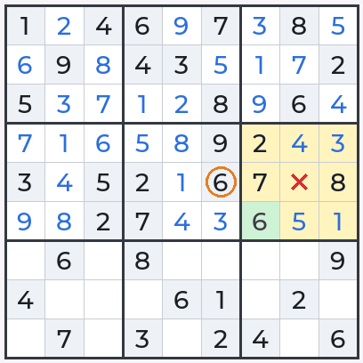

#### Step 32: the 9 in box 6

Box 6 needs a 9, and r5c8 is its last empty cell: **r5c8 = 9**.

#### Step 33: the 2 in box 7

Box 7 needs a 2. r7c3: column 3 has one (r6c3). r8c2 and r8c3: row 8 has one (r8c8). r9c1 and r9c3: row 9 has one (r9c6). Only **r7c1** is left: **r7c1 = 2**.

#### Step 34: the 5 in box 7

Box 7 needs a 5. r7c3, r8c3 and r9c3: column 3 has one (r5c3). r9c1: column 1 has one (r3c1). Only **r8c2** is left: **r8c2 = 5**.

#### Step 35: the 8 in box 7

Box 7 needs an 8. r7c3: row 7 has one (r7c4). r8c3 and r9c3: column 3 has one (r2c3). Only **r9c1** is left: **r9c1 = 8**.

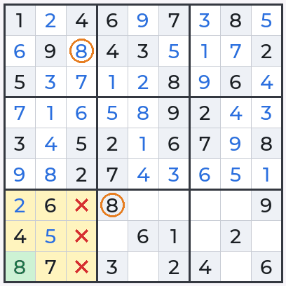

#### Step 36: the 9 in box 7

Box 7 needs a 9. r7c3: row 7 has one (r7c9). r8c3: it touches the 8 in r7c4 at a corner, and 9 is 1 away from it. Only **r9c3** is left: **r9c3 = 9**.

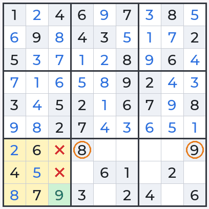

#### Step 37: the 1 in box 7

Box 7 needs a 1. r8c3: row 8 has one (r8c6). Only **r7c3** is left: **r7c3 = 1**.

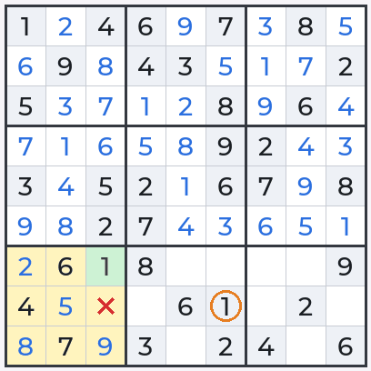

#### Step 38: the 3 in box 7

Box 7 needs a 3, and r8c3 is its last empty cell: **r8c3 = 3**.

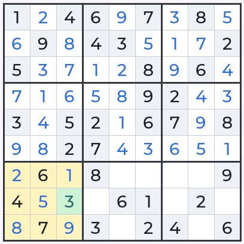

#### Step 39: the 4 in box 8

Box 8 needs a 4. r7c5: column 5 has one (r6c5). r8c4: row 8 has one (r8c1). r9c5: row 9 has one (r9c7). Only **r7c6** is left: **r7c6 = 4**.

#### Step 40: the 7 in box 8

Box 8 needs a 7. r8c4: column 4 has one (r6c4). r9c5: row 9 has one (r9c2). Only **r7c5** is left: **r7c5 = 7**.

#### Step 41: the 5 in box 8

Box 8 needs a 5. r8c4: row 8 has one (r8c2). Only **r9c5** is left: **r9c5 = 5**.

#### Step 42: the 9 in box 8

Box 8 needs a 9, and r8c4 is its last empty cell: **r8c4 = 9**.

#### Step 43: the 1 in box 9

Box 9 needs a 1. r7c7 and r7c8: row 7 has one (r7c3). r8c7 and r8c9: row 8 has one (r8c6). Only **r9c8** is left: **r9c8 = 1**.

#### Step 44: the 3 in box 9

Box 9 needs a 3. r7c7: column 7 has one (r1c7). r8c7 and r8c9: row 8 has one (r8c3). Only **r7c8** is left: **r7c8 = 3**.

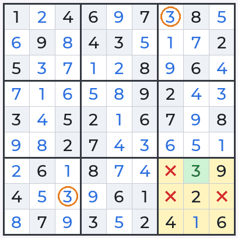

#### Step 45: the 5 in box 9

Box 9 needs a 5. r8c7 and r8c9: row 8 has one (r8c2). Only **r7c7** is left: **r7c7 = 5**.

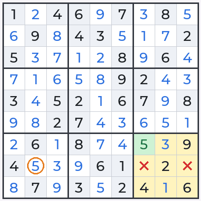

#### Step 46: the 7 in box 9

Box 9 needs a 7. r8c7: column 7 has one (r5c7). Only **r8c9** is left: **r8c9 = 7**.

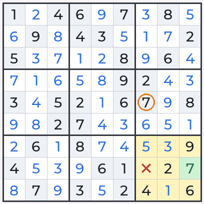

#### Step 47: the 8 in box 9

Box 9 needs an 8, and r8c7 is its last empty cell: **r8c7 = 8**.

Solved.

<!-- /walkthrough -->
