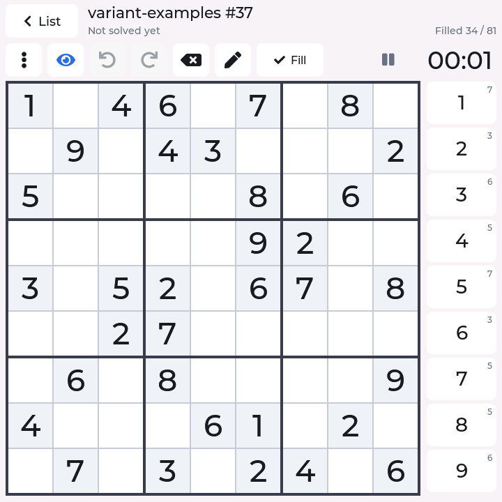
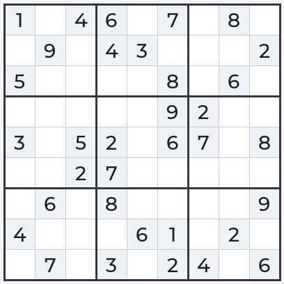

# Diagonal Non-Consecutive

[← All variants](README.md) · [Puzzles](../features-puzzles.md) · [How to play](../how-to-play.md)

## The rules

[Classic](classic.md) rules, and **two cells that touch at a corner never hold digits 1 apart**: next to a 5, the four cells diagonally around it can't be 4 or 6. Side by side doesn't count (that's [Non-Consecutive](non-consecutive.md)): a 4 can sit right next to a 5.

## On the board

- Nothing extra is drawn: the rule is about every cell.
- Two digits 1 apart at a corner turn red.
- The grader and hints take a digit out of a cell when a cell at its corner can only be one of its two neighbours: "The cells touching row 3, column 3 at its corners can't be 1 apart from it, which leaves it only 7".
- **Puzzles → ⋮ → New puzzle → Marks → Diagonal NC**.

## How to solve it

- **Each digit rules out two more at its corners:** a 5 keeps 4 and 6 out of its four diagonal neighbours, on top of its row, column and box.
- **1 and 9 are the gentlest:** they rule out only one digit at their corners (2, or 8).
- **A corner cell with two candidates 2 apart** (like 4 and 6) keeps the digit between them (5) out of the cells at its corners.
- **Inside a box, the corners count too:** a box's centre touches all four of its corner cells.

## Worked example

**variant-examples #37**, Diagonal Non-Consecutive Easy (see [Classic](classic.md#worked-example-the-whole-puzzle) for how to import the examples; cells are written r*row*c*column*).

**Step 1: r2c7.** Row 2 has 2, 3, 4 and 9; column 7 has a 7; box 3 has 6 and 8: that leaves 1 and 5. r3c8, at its lower-right corner, is a 6: a 5 would be 1 away. **r2c7 = 1**.

**Step 2: r3c3.** Row 3 has 5, 6 and 8; column 3 has 2 and 4; box 1 has 1 and 9: that leaves 3 and 7. r2c4, at its upper-right corner, is a 4: a 3 would be 1 away. **r3c3 = 7**.

**Step 3: r5c2.** Row 5 has 2, 3, 5, 6, 7 and 8; column 2 has a 9: that leaves 1 and 4. r6c3, at its lower-right corner, is a 2: a 1 would be 1 away. **r5c2 = 4**.

## The whole puzzle, step by step

<!-- walkthrough -->
<!-- Written by tools/walkthrough.py diagonal-non-consecutive: edit the script, not this part. -->

The whole puzzle, from the start to the last cell: 47 steps, each one a single (one place left for a digit, or one digit left for a cell), taken in the order a box's single comes first, so not quite the order of the worked example above. Each step has a page of its own, with **Previous** and **Next**: pick its number below. In each picture, the unit the step looks at is tinted yellow (for a cell with one digit left: its row, column and box), the new digit is on green, the digits that rule cells out have an **orange ring**, and the empty cells they rule out a **red cross**. Givens are on grey, digits from earlier steps in blue.

| [1](diagonal-non-consecutive/step-01.md) | [2](diagonal-non-consecutive/step-02.md) | [3](diagonal-non-consecutive/step-03.md) | [4](diagonal-non-consecutive/step-04.md) | [5](diagonal-non-consecutive/step-05.md) | [6](diagonal-non-consecutive/step-06.md) | [7](diagonal-non-consecutive/step-07.md) | [8](diagonal-non-consecutive/step-08.md) | [9](diagonal-non-consecutive/step-09.md) | [10](diagonal-non-consecutive/step-10.md) |
|:-:|:-:|:-:|:-:|:-:|:-:|:-:|:-:|:-:|:-:|
| [11](diagonal-non-consecutive/step-11.md) | [12](diagonal-non-consecutive/step-12.md) | [13](diagonal-non-consecutive/step-13.md) | [14](diagonal-non-consecutive/step-14.md) | [15](diagonal-non-consecutive/step-15.md) | [16](diagonal-non-consecutive/step-16.md) | [17](diagonal-non-consecutive/step-17.md) | [18](diagonal-non-consecutive/step-18.md) | [19](diagonal-non-consecutive/step-19.md) | [20](diagonal-non-consecutive/step-20.md) |
| [21](diagonal-non-consecutive/step-21.md) | [22](diagonal-non-consecutive/step-22.md) | [23](diagonal-non-consecutive/step-23.md) | [24](diagonal-non-consecutive/step-24.md) | [25](diagonal-non-consecutive/step-25.md) | [26](diagonal-non-consecutive/step-26.md) | [27](diagonal-non-consecutive/step-27.md) | [28](diagonal-non-consecutive/step-28.md) | [29](diagonal-non-consecutive/step-29.md) | [30](diagonal-non-consecutive/step-30.md) |
| [31](diagonal-non-consecutive/step-31.md) | [32](diagonal-non-consecutive/step-32.md) | [33](diagonal-non-consecutive/step-33.md) | [34](diagonal-non-consecutive/step-34.md) | [35](diagonal-non-consecutive/step-35.md) | [36](diagonal-non-consecutive/step-36.md) | [37](diagonal-non-consecutive/step-37.md) | [38](diagonal-non-consecutive/step-38.md) | [39](diagonal-non-consecutive/step-39.md) | [40](diagonal-non-consecutive/step-40.md) |
| [41](diagonal-non-consecutive/step-41.md) | [42](diagonal-non-consecutive/step-42.md) | [43](diagonal-non-consecutive/step-43.md) | [44](diagonal-non-consecutive/step-44.md) | [45](diagonal-non-consecutive/step-45.md) | [46](diagonal-non-consecutive/step-46.md) | [47](diagonal-non-consecutive/step-47.md) |  |  |  |

Solved.

<!-- /walkthrough -->
