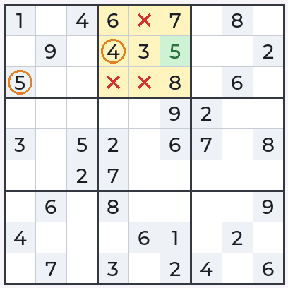

<!-- Written by tools/walkthrough.py diagonal-non-consecutive: edit the script, not this page. -->
# Diagonal Non-Consecutive, step 1: the 5 in box 2

**Step 1 of 47** · [← The start](../diagonal-non-consecutive.md#the-whole-puzzle-step-by-step) · [All steps](../diagonal-non-consecutive.md#the-whole-puzzle-step-by-step) · [Step 2 →](step-02.md)

Box 2 needs a 5. r3c4 and r3c5: row 3 has one (r3c1). r1c5: it touches the 4 in r2c4 at a corner, and 5 is 1 away from it. Only **r2c6** is left: **r2c6 = 5**.

**Step 1 of 47** · [← The start](../diagonal-non-consecutive.md#the-whole-puzzle-step-by-step) · [All steps](../diagonal-non-consecutive.md#the-whole-puzzle-step-by-step) · [Step 2 →](step-02.md)
