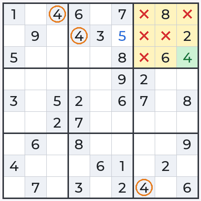

<!-- Written by tools/walkthrough.py diagonal-non-consecutive: edit the script, not this page. -->
# Diagonal Non-Consecutive, step 2: the 4 in box 3

**Step 2 of 47** · [← Step 1](step-01.md) · [All steps](../diagonal-non-consecutive.md#the-whole-puzzle-step-by-step) · [Step 3 →](step-03.md)

Box 3 needs a 4. r1c7 and r1c9: row 1 has one (r1c3). r2c7 and r2c8: row 2 has one (r2c4). r3c7: column 7 has one (r9c7). Only **r3c9** is left: **r3c9 = 4**.

**Step 2 of 47** · [← Step 1](step-01.md) · [All steps](../diagonal-non-consecutive.md#the-whole-puzzle-step-by-step) · [Step 3 →](step-03.md)
