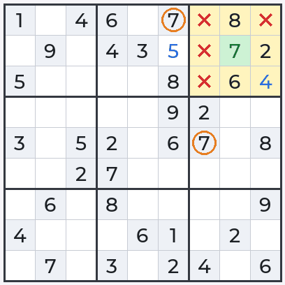

<!-- Written by tools/walkthrough.py diagonal-non-consecutive: edit the script, not this page. -->
# Diagonal Non-Consecutive, step 3: the 7 in box 3

**Step 3 of 47** · [← Step 2](step-02.md) · [All steps](../diagonal-non-consecutive.md#the-whole-puzzle-step-by-step) · [Step 4 →](step-04.md)

Box 3 needs a 7. r1c7 and r1c9: row 1 has one (r1c6). r2c7 and r3c7: column 7 has one (r5c7). Only **r2c8** is left: **r2c8 = 7**.

**Step 3 of 47** · [← Step 2](step-02.md) · [All steps](../diagonal-non-consecutive.md#the-whole-puzzle-step-by-step) · [Step 4 →](step-04.md)
