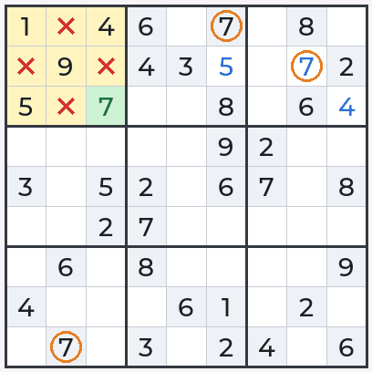

<!-- Written by tools/walkthrough.py diagonal-non-consecutive: edit the script, not this page. -->
# Diagonal Non-Consecutive, step 4: the 7 in box 1

**Step 4 of 47** · [← Step 3](step-03.md) · [All steps](../diagonal-non-consecutive.md#the-whole-puzzle-step-by-step) · [Step 5 →](step-05.md)

Box 1 needs a 7. r1c2: row 1 has one (r1c6). r2c1 and r2c3: row 2 has one (r2c8). r3c2: column 2 has one (r9c2). Only **r3c3** is left: **r3c3 = 7**.

**Step 4 of 47** · [← Step 3](step-03.md) · [All steps](../diagonal-non-consecutive.md#the-whole-puzzle-step-by-step) · [Step 5 →](step-05.md)
