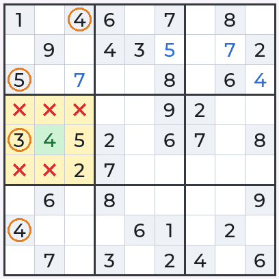

<!-- Written by tools/walkthrough.py diagonal-non-consecutive: edit the script, not this page. -->
# Diagonal Non-Consecutive, step 5: the 4 in box 4

**Step 5 of 47** · [← Step 4](step-04.md) · [All steps](../diagonal-non-consecutive.md#the-whole-puzzle-step-by-step) · [Step 6 →](step-06.md)

Box 4 needs a 4. r4c1 and r6c1: column 1 has one (r8c1). r4c3: column 3 has one (r1c3). r4c2: it touches the 5 in r3c1 at a corner, and 4 is 1 away from it. r6c2: it touches the 3 in r5c1 at a corner, and 4 is 1 away from it. Only **r5c2** is left: **r5c2 = 4**.

**Step 5 of 47** · [← Step 4](step-04.md) · [All steps](../diagonal-non-consecutive.md#the-whole-puzzle-step-by-step) · [Step 6 →](step-06.md)
