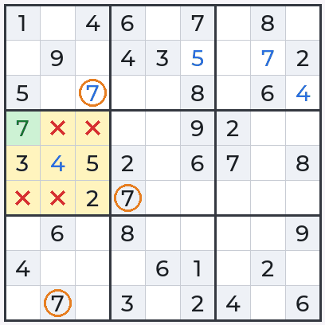

<!-- Written by tools/walkthrough.py diagonal-non-consecutive: edit the script, not this page. -->
# Diagonal Non-Consecutive, step 6: the 7 in box 4

**Step 6 of 47** · [← Step 5](step-05.md) · [All steps](../diagonal-non-consecutive.md#the-whole-puzzle-step-by-step) · [Step 7 →](step-07.md)

Box 4 needs a 7. r4c2: column 2 has one (r9c2). r4c3: column 3 has one (r3c3). r6c1 and r6c2: row 6 has one (r6c4). Only **r4c1** is left: **r4c1 = 7**.

**Step 6 of 47** · [← Step 5](step-05.md) · [All steps](../diagonal-non-consecutive.md#the-whole-puzzle-step-by-step) · [Step 7 →](step-07.md)
