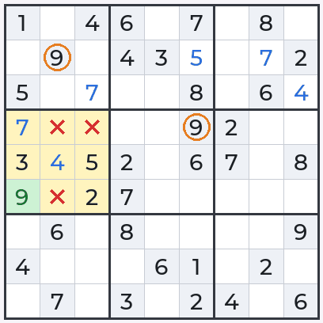

<!-- Written by tools/walkthrough.py diagonal-non-consecutive: edit the script, not this page. -->
# Diagonal Non-Consecutive, step 7: the 9 in box 4

**Step 7 of 47** · [← Step 6](step-06.md) · [All steps](../diagonal-non-consecutive.md#the-whole-puzzle-step-by-step) · [Step 8 →](step-08.md)

Box 4 needs a 9. r4c2 and r4c3: row 4 has one (r4c6). r6c2: column 2 has one (r2c2). Only **r6c1** is left: **r6c1 = 9**.

**Step 7 of 47** · [← Step 6](step-06.md) · [All steps](../diagonal-non-consecutive.md#the-whole-puzzle-step-by-step) · [Step 8 →](step-08.md)
