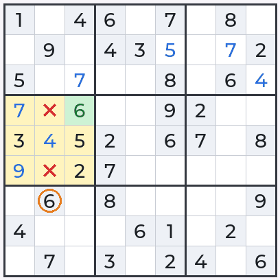

<!-- Written by tools/walkthrough.py diagonal-non-consecutive: edit the script, not this page. -->
# Diagonal Non-Consecutive, step 8: the 6 in box 4

**Step 8 of 47** · [← Step 7](step-07.md) · [All steps](../diagonal-non-consecutive.md#the-whole-puzzle-step-by-step) · [Step 9 →](step-09.md)

Box 4 needs a 6. r4c2 and r6c2: column 2 has one (r7c2). Only **r4c3** is left: **r4c3 = 6**.

**Step 8 of 47** · [← Step 7](step-07.md) · [All steps](../diagonal-non-consecutive.md#the-whole-puzzle-step-by-step) · [Step 9 →](step-09.md)
