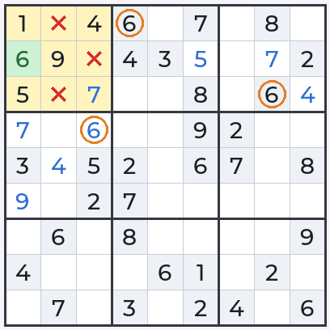

<!-- Written by tools/walkthrough.py diagonal-non-consecutive: edit the script, not this page. -->
# Diagonal Non-Consecutive, step 9: the 6 in box 1

**Step 9 of 47** · [← Step 8](step-08.md) · [All steps](../diagonal-non-consecutive.md#the-whole-puzzle-step-by-step) · [Step 10 →](step-10.md)

Box 1 needs a 6. r1c2: row 1 has one (r1c4). r2c3: column 3 has one (r4c3). r3c2: row 3 has one (r3c8). Only **r2c1** is left: **r2c1 = 6**.

**Step 9 of 47** · [← Step 8](step-08.md) · [All steps](../diagonal-non-consecutive.md#the-whole-puzzle-step-by-step) · [Step 10 →](step-10.md)
