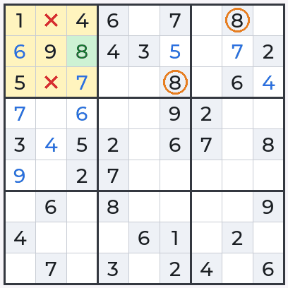

<!-- Written by tools/walkthrough.py diagonal-non-consecutive: edit the script, not this page. -->
# Diagonal Non-Consecutive, step 10: the 8 in box 1

**Step 10 of 47** · [← Step 9](step-09.md) · [All steps](../diagonal-non-consecutive.md#the-whole-puzzle-step-by-step) · [Step 11 →](step-11.md)

Box 1 needs an 8. r1c2: row 1 has one (r1c8). r3c2: row 3 has one (r3c6). Only **r2c3** is left: **r2c3 = 8**.

**Step 10 of 47** · [← Step 9](step-09.md) · [All steps](../diagonal-non-consecutive.md#the-whole-puzzle-step-by-step) · [Step 11 →](step-11.md)
