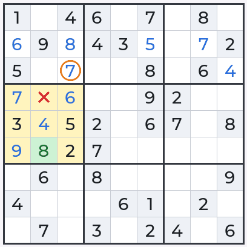

<!-- Written by tools/walkthrough.py diagonal-non-consecutive: edit the script, not this page. -->
# Diagonal Non-Consecutive, step 11: the 8 in box 4

**Step 11 of 47** · [← Step 10](step-10.md) · [All steps](../diagonal-non-consecutive.md#the-whole-puzzle-step-by-step) · [Step 12 →](step-12.md)

Box 4 needs an 8. r4c2: it touches the 7 in r3c3 at a corner, and 8 is 1 away from it. Only **r6c2** is left: **r6c2 = 8**.

**Step 11 of 47** · [← Step 10](step-10.md) · [All steps](../diagonal-non-consecutive.md#the-whole-puzzle-step-by-step) · [Step 12 →](step-12.md)
