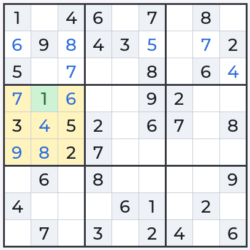

<!-- Written by tools/walkthrough.py diagonal-non-consecutive: edit the script, not this page. -->
# Diagonal Non-Consecutive, step 12: the 1 in box 4

**Step 12 of 47** · [← Step 11](step-11.md) · [All steps](../diagonal-non-consecutive.md#the-whole-puzzle-step-by-step) · [Step 13 →](step-13.md)

Box 4 needs a 1, and r4c2 is its last empty cell: **r4c2 = 1**.

**Step 12 of 47** · [← Step 11](step-11.md) · [All steps](../diagonal-non-consecutive.md#the-whole-puzzle-step-by-step) · [Step 13 →](step-13.md)
