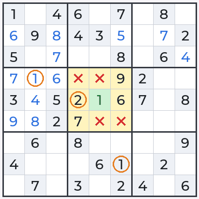

<!-- Written by tools/walkthrough.py diagonal-non-consecutive: edit the script, not this page. -->
# Diagonal Non-Consecutive, step 13: the 1 in box 5

**Step 13 of 47** · [← Step 12](step-12.md) · [All steps](../diagonal-non-consecutive.md#the-whole-puzzle-step-by-step) · [Step 14 →](step-14.md)

Box 5 needs a 1. r4c4 and r4c5: row 4 has one (r4c2). r6c6: column 6 has one (r8c6). r6c5: it touches the 2 in r5c4 at a corner, and 1 is 1 away from it. Only **r5c5** is left: **r5c5 = 1**.

**Step 13 of 47** · [← Step 12](step-12.md) · [All steps](../diagonal-non-consecutive.md#the-whole-puzzle-step-by-step) · [Step 14 →](step-14.md)
