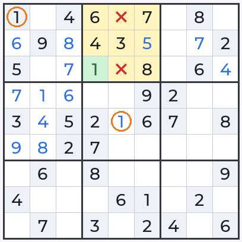

<!-- Written by tools/walkthrough.py diagonal-non-consecutive: edit the script, not this page. -->
# Diagonal Non-Consecutive, step 14: the 1 in box 2

**Step 14 of 47** · [← Step 13](step-13.md) · [All steps](../diagonal-non-consecutive.md#the-whole-puzzle-step-by-step) · [Step 15 →](step-15.md)

Box 2 needs a 1. r1c5: row 1 has one (r1c1). r3c5: column 5 has one (r5c5). Only **r3c4** is left: **r3c4 = 1**.

**Step 14 of 47** · [← Step 13](step-13.md) · [All steps](../diagonal-non-consecutive.md#the-whole-puzzle-step-by-step) · [Step 15 →](step-15.md)
