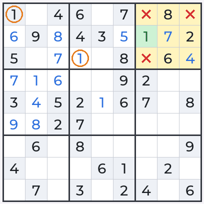

<!-- Written by tools/walkthrough.py diagonal-non-consecutive: edit the script, not this page. -->
# Diagonal Non-Consecutive, step 15: the 1 in box 3

**Step 15 of 47** · [← Step 14](step-14.md) · [All steps](../diagonal-non-consecutive.md#the-whole-puzzle-step-by-step) · [Step 16 →](step-16.md)

Box 3 needs a 1. r1c7 and r1c9: row 1 has one (r1c1). r3c7: row 3 has one (r3c4). Only **r2c7** is left: **r2c7 = 1**.

**Step 15 of 47** · [← Step 14](step-14.md) · [All steps](../diagonal-non-consecutive.md#the-whole-puzzle-step-by-step) · [Step 16 →](step-16.md)
