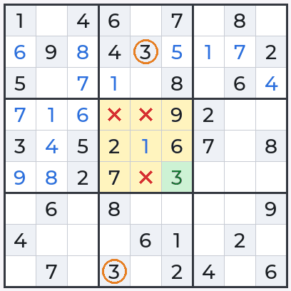

<!-- Written by tools/walkthrough.py diagonal-non-consecutive: edit the script, not this page. -->
# Diagonal Non-Consecutive, step 16: the 3 in box 5

**Step 16 of 47** · [← Step 15](step-15.md) · [All steps](../diagonal-non-consecutive.md#the-whole-puzzle-step-by-step) · [Step 17 →](step-17.md)

Box 5 needs a 3. r4c4: column 4 has one (r9c4). r4c5 and r6c5: column 5 has one (r2c5). Only **r6c6** is left: **r6c6 = 3**.

**Step 16 of 47** · [← Step 15](step-15.md) · [All steps](../diagonal-non-consecutive.md#the-whole-puzzle-step-by-step) · [Step 17 →](step-17.md)
