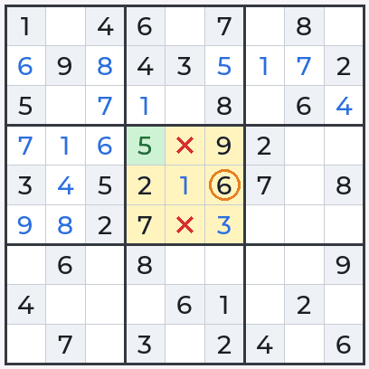

<!-- Written by tools/walkthrough.py diagonal-non-consecutive: edit the script, not this page. -->
# Diagonal Non-Consecutive, step 17: the 5 in box 5

**Step 17 of 47** · [← Step 16](step-16.md) · [All steps](../diagonal-non-consecutive.md#the-whole-puzzle-step-by-step) · [Step 18 →](step-18.md)

Box 5 needs a 5. r4c5 and r6c5: it touches the 6 in r5c6 at a corner, and 5 is 1 away from it. Only **r4c4** is left: **r4c4 = 5**.

**Step 17 of 47** · [← Step 16](step-16.md) · [All steps](../diagonal-non-consecutive.md#the-whole-puzzle-step-by-step) · [Step 18 →](step-18.md)
