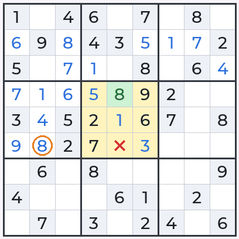

<!-- Written by tools/walkthrough.py diagonal-non-consecutive: edit the script, not this page. -->
# Diagonal Non-Consecutive, step 18: the 8 in box 5

**Step 18 of 47** · [← Step 17](step-17.md) · [All steps](../diagonal-non-consecutive.md#the-whole-puzzle-step-by-step) · [Step 19 →](step-19.md)

Box 5 needs an 8. r6c5: row 6 has one (r6c2). Only **r4c5** is left: **r4c5 = 8**.

**Step 18 of 47** · [← Step 17](step-17.md) · [All steps](../diagonal-non-consecutive.md#the-whole-puzzle-step-by-step) · [Step 19 →](step-19.md)
