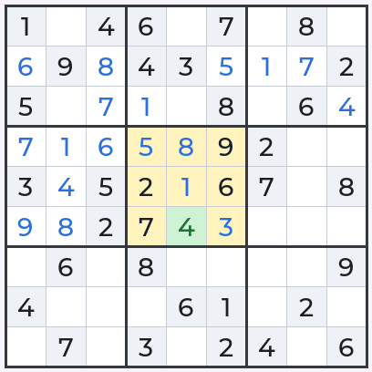

<!-- Written by tools/walkthrough.py diagonal-non-consecutive: edit the script, not this page. -->
# Diagonal Non-Consecutive, step 19: the 4 in box 5

**Step 19 of 47** · [← Step 18](step-18.md) · [All steps](../diagonal-non-consecutive.md#the-whole-puzzle-step-by-step) · [Step 20 →](step-20.md)

Box 5 needs a 4, and r6c5 is its last empty cell: **r6c5 = 4**.

**Step 19 of 47** · [← Step 18](step-18.md) · [All steps](../diagonal-non-consecutive.md#the-whole-puzzle-step-by-step) · [Step 20 →](step-20.md)
