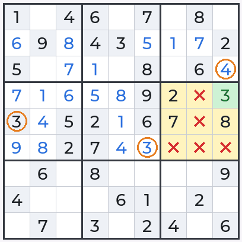

<!-- Written by tools/walkthrough.py diagonal-non-consecutive: edit the script, not this page. -->
# Diagonal Non-Consecutive, step 20: the 3 in box 6

**Step 20 of 47** · [← Step 19](step-19.md) · [All steps](../diagonal-non-consecutive.md#the-whole-puzzle-step-by-step) · [Step 21 →](step-21.md)

Box 6 needs a 3. r5c8: row 5 has one (r5c1). r6c7, r6c8 and r6c9: row 6 has one (r6c6). r4c8: it touches the 4 in r3c9 at a corner, and 3 is 1 away from it. Only **r4c9** is left: **r4c9 = 3**.

**Step 20 of 47** · [← Step 19](step-19.md) · [All steps](../diagonal-non-consecutive.md#the-whole-puzzle-step-by-step) · [Step 21 →](step-21.md)
