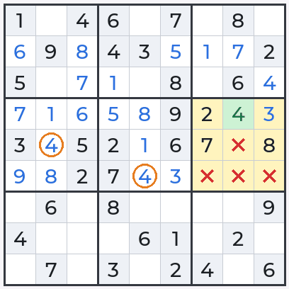

<!-- Written by tools/walkthrough.py diagonal-non-consecutive: edit the script, not this page. -->
# Diagonal Non-Consecutive, step 21: the 4 in box 6

**Step 21 of 47** · [← Step 20](step-20.md) · [All steps](../diagonal-non-consecutive.md#the-whole-puzzle-step-by-step) · [Step 22 →](step-22.md)

Box 6 needs a 4. r5c8: row 5 has one (r5c2). r6c7, r6c8 and r6c9: row 6 has one (r6c5). Only **r4c8** is left: **r4c8 = 4**.

**Step 21 of 47** · [← Step 20](step-20.md) · [All steps](../diagonal-non-consecutive.md#the-whole-puzzle-step-by-step) · [Step 22 →](step-22.md)
