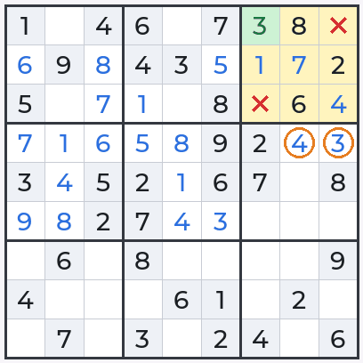

<!-- Written by tools/walkthrough.py diagonal-non-consecutive: edit the script, not this page. -->
# Diagonal Non-Consecutive, step 22: the 3 in box 3

**Step 22 of 47** · [← Step 21](step-21.md) · [All steps](../diagonal-non-consecutive.md#the-whole-puzzle-step-by-step) · [Step 23 →](step-23.md)

Box 3 needs a 3. r1c9: column 9 has one (r4c9). r3c7: it touches the 4 in r4c8 at a corner, and 3 is 1 away from it. Only **r1c7** is left: **r1c7 = 3**.

**Step 22 of 47** · [← Step 21](step-21.md) · [All steps](../diagonal-non-consecutive.md#the-whole-puzzle-step-by-step) · [Step 23 →](step-23.md)
