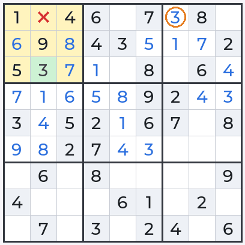

<!-- Written by tools/walkthrough.py diagonal-non-consecutive: edit the script, not this page. -->
# Diagonal Non-Consecutive, step 23: the 3 in box 1

**Step 23 of 47** · [← Step 22](step-22.md) · [All steps](../diagonal-non-consecutive.md#the-whole-puzzle-step-by-step) · [Step 24 →](step-24.md)

Box 1 needs a 3. r1c2: row 1 has one (r1c7). Only **r3c2** is left: **r3c2 = 3**.

**Step 23 of 47** · [← Step 22](step-22.md) · [All steps](../diagonal-non-consecutive.md#the-whole-puzzle-step-by-step) · [Step 24 →](step-24.md)
