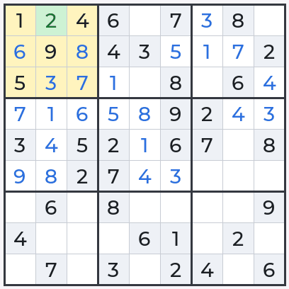

<!-- Written by tools/walkthrough.py diagonal-non-consecutive: edit the script, not this page. -->
# Diagonal Non-Consecutive, step 24: the 2 in box 1

**Step 24 of 47** · [← Step 23](step-23.md) · [All steps](../diagonal-non-consecutive.md#the-whole-puzzle-step-by-step) · [Step 25 →](step-25.md)

Box 1 needs a 2, and r1c2 is its last empty cell: **r1c2 = 2**.

**Step 24 of 47** · [← Step 23](step-23.md) · [All steps](../diagonal-non-consecutive.md#the-whole-puzzle-step-by-step) · [Step 25 →](step-25.md)
