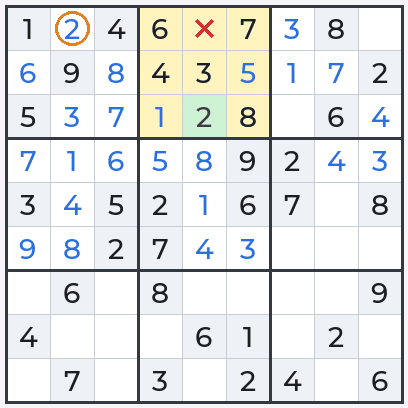

<!-- Written by tools/walkthrough.py diagonal-non-consecutive: edit the script, not this page. -->
# Diagonal Non-Consecutive, step 25: the 2 in box 2

**Step 25 of 47** · [← Step 24](step-24.md) · [All steps](../diagonal-non-consecutive.md#the-whole-puzzle-step-by-step) · [Step 26 →](step-26.md)

Box 2 needs a 2. r1c5: row 1 has one (r1c2). Only **r3c5** is left: **r3c5 = 2**.

**Step 25 of 47** · [← Step 24](step-24.md) · [All steps](../diagonal-non-consecutive.md#the-whole-puzzle-step-by-step) · [Step 26 →](step-26.md)
