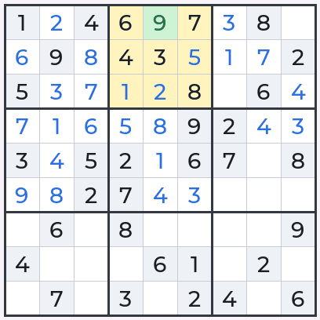

<!-- Written by tools/walkthrough.py diagonal-non-consecutive: edit the script, not this page. -->
# Diagonal Non-Consecutive, step 26: the 9 in box 2

**Step 26 of 47** · [← Step 25](step-25.md) · [All steps](../diagonal-non-consecutive.md#the-whole-puzzle-step-by-step) · [Step 27 →](step-27.md)

Box 2 needs a 9, and r1c5 is its last empty cell: **r1c5 = 9**.

**Step 26 of 47** · [← Step 25](step-25.md) · [All steps](../diagonal-non-consecutive.md#the-whole-puzzle-step-by-step) · [Step 27 →](step-27.md)
