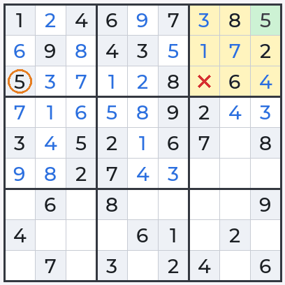

<!-- Written by tools/walkthrough.py diagonal-non-consecutive: edit the script, not this page. -->
# Diagonal Non-Consecutive, step 27: the 5 in box 3

**Step 27 of 47** · [← Step 26](step-26.md) · [All steps](../diagonal-non-consecutive.md#the-whole-puzzle-step-by-step) · [Step 28 →](step-28.md)

Box 3 needs a 5. r3c7: row 3 has one (r3c1). Only **r1c9** is left: **r1c9 = 5**.

**Step 27 of 47** · [← Step 26](step-26.md) · [All steps](../diagonal-non-consecutive.md#the-whole-puzzle-step-by-step) · [Step 28 →](step-28.md)
