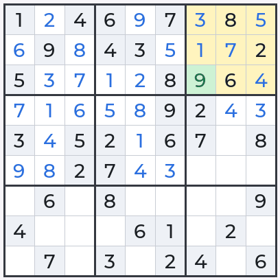

<!-- Written by tools/walkthrough.py diagonal-non-consecutive: edit the script, not this page. -->
# Diagonal Non-Consecutive, step 28: the 9 in box 3

**Step 28 of 47** · [← Step 27](step-27.md) · [All steps](../diagonal-non-consecutive.md#the-whole-puzzle-step-by-step) · [Step 29 →](step-29.md)

Box 3 needs a 9, and r3c7 is its last empty cell: **r3c7 = 9**.

**Step 28 of 47** · [← Step 27](step-27.md) · [All steps](../diagonal-non-consecutive.md#the-whole-puzzle-step-by-step) · [Step 29 →](step-29.md)
