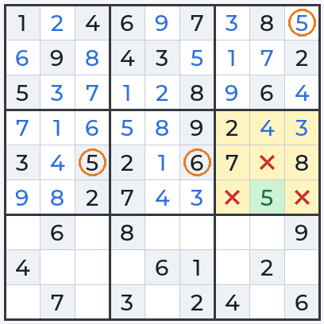

<!-- Written by tools/walkthrough.py diagonal-non-consecutive: edit the script, not this page. -->
# Diagonal Non-Consecutive, step 29: the 5 in box 6

**Step 29 of 47** · [← Step 28](step-28.md) · [All steps](../diagonal-non-consecutive.md#the-whole-puzzle-step-by-step) · [Step 30 →](step-30.md)

Box 6 needs a 5. r5c8: row 5 has one (r5c3). r6c9: column 9 has one (r1c9). r6c7: it touches the 6 in r5c6 at a corner, and 5 is 1 away from it. Only **r6c8** is left: **r6c8 = 5**.

**Step 29 of 47** · [← Step 28](step-28.md) · [All steps](../diagonal-non-consecutive.md#the-whole-puzzle-step-by-step) · [Step 30 →](step-30.md)
